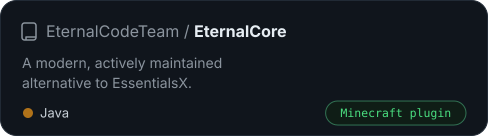
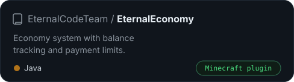

 

&nbsp;
&nbsp;

 

 

I'm a full-stack developer from Poland, studying programming at a technical school. I like building things end to end, from Java backends to TypeScript frontends, and Minecraft is still the thing I love most.

 

 

 

I'm part of [EternalCode Team](https://github.com/EternalCodeTeam), where we build open-source Minecraft plugins. Smaller things of my own: [pizzeria](https://github.com/Qbiterv/pizzeria) (Spring Boot, React, Docker) and [library-api](https://github.com/Qbiterv/library-api) (Spring Boot).

 

