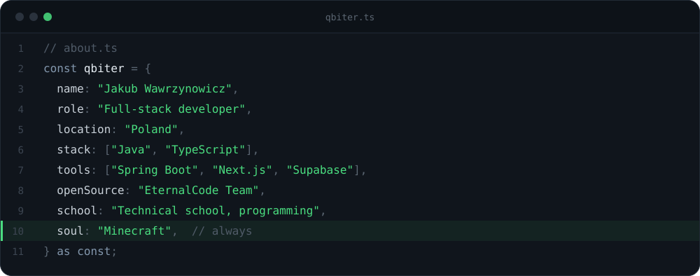
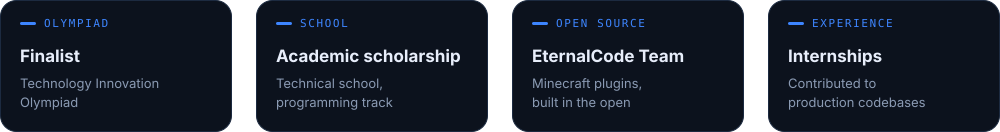
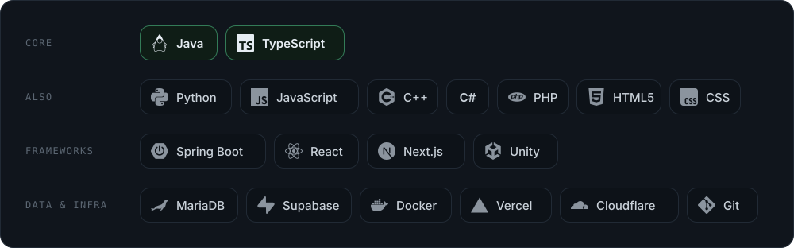
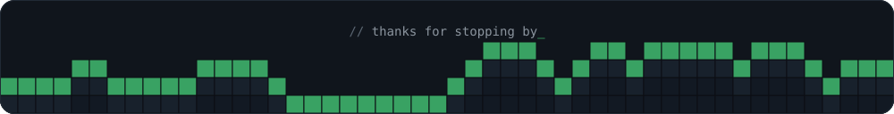

 

&nbsp;
&nbsp;

 

 

 

I'm a full-stack developer from Poland, studying programming at a technical school. I like building things end to end, from Java backends to TypeScript frontends, and Minecraft is still the thing I love most.

 

 

 

